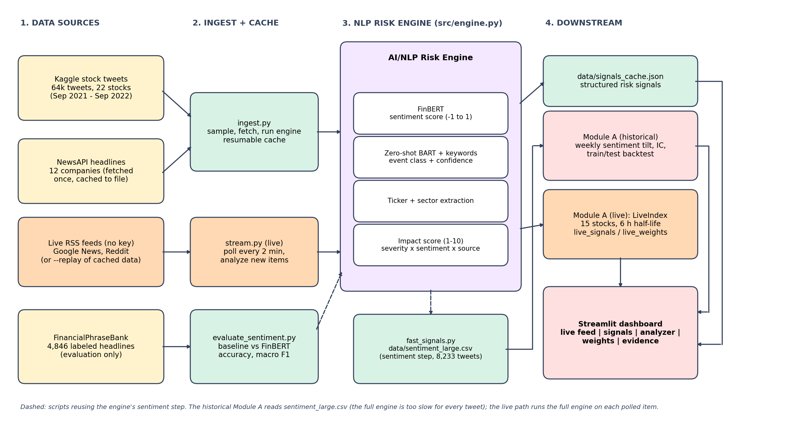

# AI/NLP Risk Engine with Sentiment-Driven Index Rebalancing - S&P Global & Crisil Campus Hackathon

**Candidate Name:** Sumit Reddy
**College Email ID:** TODO
**College / Campus:** IIT Guwahati
**Demo Video Link:** TODO (YouTube, unlisted)
**Slide Deck Link (if hosted externally):** not hosted externally - see `docs/presentation.pdf`

## 1. Project Overview / Problem Statement & Approach
Banks need to turn a constant stream of unstructured text (news, social media) into risk signals that downstream systems can act on. This project builds an **AI/NLP Risk Engine** that ingests text from two source types (financial news via NewsAPI, and Twitter/X posts from a public Kaggle dataset) and outputs, for each text, a **sentiment score** (-1 to 1), an **event class** (Geopolitical, Macroeconomic, Credit Event, Merger/Acquisition, Product Launch, plus Earnings, Regulatory/Legal, Operational/Product Incident, Analyst Rating/Price Target, Management/Corporate Action, and Market Commentary for posts that contain no discrete event) with a confidence, the **tickers** involved, and an **impact score** (1-10).

The full signals are cached to `data/signals_cache.json` (shown in the dashboard). **Module A (tactical index rebalancing)** consumes the engine's sentiment score over a larger tweet sample (`data/sentiment_large.csv`, written by `src/fast_signals.py`, which runs only the engine's sentiment step because the full engine, with zero-shot event classification, is too slow for every tweet). It tilts a 22-stock index toward positively discussed stocks each week (historical backtest). A separate **live pipeline** (`src/stream.py`) polls free public feeds (Google News and Reddit RSS) every 2 minutes, runs each new item through the full engine, and updates a streaming version of Module A (`src/live_index.py`: 15 large-cap S&P 100 stocks, sentiment fading with a 6-hour half-life) that the dashboard's **Live feed** tab shows as it happens. An offline `--replay` mode plays cached data as a simulated feed for demos without internet; it is clearly labeled REPLAY in the dashboard. In the dashboard's **Analyze text** tab, every text you analyze is also applied to a session-local copy of the live index, so you can type a headline and watch the weights move (the Index weights tab, in contrast, is the precomputed historical backtest and does not react). The project is evaluated honestly: the sentiment model is scored on a labeled dataset against a keyword baseline, and the rebalancing strategy is tested out-of-sample with no look-ahead, trading costs and a train/test split. **The main finding is negative: weekly tweet sentiment showed no statistically significant ability to predict next-week returns in this sample** (see section 5).

## 2. Architecture & Tech Stack


- **Sentiment:** FinBERT (`ProsusAI/finbert`), score = P(positive) - P(negative). **Event class:** zero-shot BART (`facebook/bart-large-mnli`) with a whole-word keyword fallback when model confidence is low. **Impact:** event severity x sentiment strength x source weight (a hand-set heuristic, not validated).
- **Stack:** Python, Hugging Face Transformers + PyTorch, pandas/numpy, yfinance (prices), NewsAPI, Streamlit (dashboard), matplotlib, scikit-learn (evaluation).
- **Code:** `src/engine.py` (NLP engine), `src/ingest.py` (sampling, news fetch, cached build), `src/evaluate_sentiment.py`, `src/fast_signals.py` (FinBERT-only pass for the backtest), `src/backtest_v2.py` (Module A test), `src/app.py` (dashboard), and the live pipeline: `src/stream.py` (poll, analyze, update), `src/live_feed.py` (sources and replay), `src/live_index.py` (streaming Module A). `src/module_a.py` and `src/backtest.py` are an earlier, smaller-sample version kept for reference.

## 3. Dataset Used
- **Tweets:** Kaggle "Stock Tweets for Sentiment Analysis and Prediction" (80,793 raw rows, 64,198 usable after cleaning; 22 stocks; 2021-09-30 to 2022-09-29). `data/tweets_sample.csv` is a 1,405-tweet stratified sample (the full file is not committed to keep the repo small). Please check the dataset's Kaggle page for its license.
- **News:** NewsAPI headlines for 12 companies, fetched once and cached in `data/news_cache.json` (206 articles, recent dates, so they are used for the live-signal view only, not the historical backtest).
- **Sentiment evaluation:** FinancialPhraseBank (Malo et al., 2014; Kaggle "Sentiment Analysis for Financial News", CC BY-NC-SA 4.0), 4,846 labeled headlines in `data/all-data.csv`, used only to evaluate sentiment.
- **Live feeds (no key needed):** Google News RSS and Reddit search RSS (r/stocks, r/investing, r/wallstreetbets, r/StockMarket), optionally Yahoo Finance headline RSS, polled by `src/stream.py`. Outputs go to `outputs/live_*` and are not committed. Reddit stands in for Twitter/X in live mode, because the Twitter/X API is not free.
- **Prices:** Yahoo Finance via yfinance, cached in `data/prices.csv`. **Synthetic:** `data/sample_texts.json` is a small hand-written sample.
- **Assumptions:** tweets proxy retail sentiment; a stock-week with no tweets is treated as neutral; the backtest sentiment file (`data/sentiment_large.csv`) covers 8,233 tweets (up to 15 per stock-week, about 7 per stock-week on average), chosen at random with a fixed seed.

## 4. Quickstart & Installation
Runtime: Python 3.x (TODO: add your version from `python --version`) on Windows (TODO: add version)

The dashboard reads cached results, so it needs only the light requirements (no model downloads, no API keys, no internet):
```bash
git clone https://github.com/sumitreddy123/IIT_Guwahati-Sumit_Reddy-hackathon
cd IIT_Guwahati-Sumit_Reddy-hackathon
pip install -r requirements.txt
streamlit run src/app.py
```
Open http://localhost:8501. If Streamlit asks for an email on first run, just press Enter. The "Analyze text" tab loads the models on first use only if `requirements-rebuild.txt` is installed; otherwise it uses a keyword fallback and says so.

**Live feed tab** (optional; run in a second terminal while the dashboard is open):
```bash
python src/stream.py --replay          # offline demo: cached data replayed as a simulated feed (labeled REPLAY)
python src/stream.py                   # live: Google News + Reddit every 2 minutes (needs internet and the models)
python src/stream.py --fast --replay   # keyword backend, works with the light requirements only (lower quality)
```

**Optional - reproduce the cached data** (slow; downloads about 2 GB of models and needs your own NewsAPI key):
```bash
pip install -r requirements-rebuild.txt
python src/evaluate_sentiment.py                      # FinBERT vs baseline (set NLP_BACKEND=lexicon for the baseline)
python src/ingest.py sample --csv path/to/stock_tweets.csv --n 1500
python src/ingest.py news                             # needs NEWSAPI_KEY
python src/ingest.py build                            # full engine, resumable
python src/fast_signals.py --csv path/to/stock_tweets.csv --per-cell 15
python src/backtest_v2.py
```

## 5. Key Results & Domain Impact
**Sentiment model (FinancialPhraseBank, 4,846 headlines):** FinBERT reaches accuracy 0.828 and macro F1 0.830, against 0.603 and 0.299 for a keyword baseline, which mostly predicted "neutral". FinBERT was fine-tuned on this dataset, so these scores are optimistic for new text.

**Module A test (22 stocks, 54 weeks, 8,233 tweets, 10 bps cost assumption, settings fixed in advance):**

| | Rank IC (t-stat) | Equal weight | Long-only tilt (net) | Long-short (net) |
|---|---|---|---|---|
| All weeks | +0.012 (0.42) | -32.2% | -33.4% | -26.7% |
| First half | +0.067 (1.58) | -5.1% | -4.6% | -1.3% |
| Second half | -0.041 (-1.11) | -28.6% | -30.2% | -25.7% |

The tilt did not beat equal weight, and the information coefficient is insignificant and changes sign between halves. The test period was a falling market for these stocks.

**Domain impact:** the engine shows how unstructured text becomes structured, machine-readable risk signals (sentiment, event type, tickers, impact) that a bank's downstream tools could consume, and the evaluation shows how to test such a signal rigorously before relying on it. In this sample the signal alone was not enough to drive allocation, which is itself a useful, honest result for risk teams.

**Limitations:** a text that mentions several stocks gets one text-level sentiment score, adjusted only by a simple rule (a price-move word such as "falling" or "surges" within 3 words of a stock name sets that stock's sign), so true per-company (targeted) sentiment is not solved; the backtest is historical, and the live path shows the system working in real time but its signals are not evaluated against returns; live sources are unauthenticated public feeds that can be slow, rate-limited or blocked, and Reddit replaces Twitter/X; the live index settings (6-hour half-life, z-score floor, 15-stock list) are unvalidated demo settings; the backtest index uses the 22 stocks covered by the tweet dataset rather than 10-20 S&P 100 names (the live index uses 15 S&P 100 stocks); Module B (stress testing) was not built; FinBERT scores implied negative news (for example a tax rise, stated without negative wording) as near-neutral; the zero-shot/keyword event classifier is imperfect; the impact score and the sector-to-ticker map are hand-written heuristics; one year of data and about 7 tweets per stock-week is thin; costs and slippage are simplified. **Next steps:** per-company (targeted) sentiment for multi-stock texts, a tweet-specific sentiment model (FinTwitBERT) with a model comparison, using all 64k tweets, event-level and volatility signals, and a stress-testing module.

*AI assistance (Claude) was used to help build this project; I reviewed and ran all code.*
